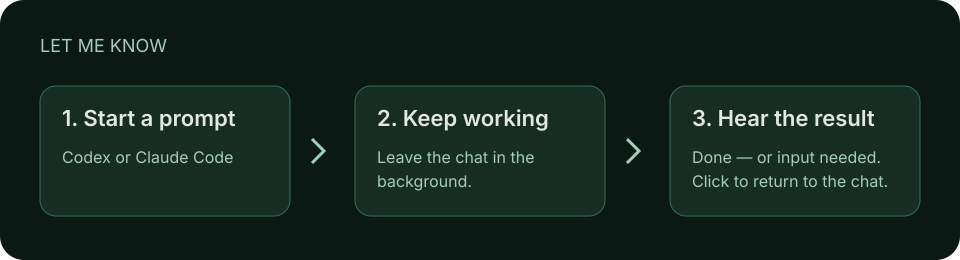

<h1>Let Me Know</h1>

<strong>Your AI is working. You don't have to keep watching.</strong>

A macOS menu-bar app for completion and input-needed alerts from Codex and Claude Code.

<a href="https://github.com/finlay28/let-me-know-releases/releases/download/v0.9.0/Let-Me-Know-0.9.0.dmg"><strong>Download for Mac · v0.9.0 preview</strong></a> · <a href="https://github.com/finlay28/let-me-know-releases/releases/tag/v0.9.0">Release notes</a> · <a href="docs/DE.md">Deutsch</a>

Apple Silicon (M1 or newer) · macOS 13+ · Audio ducking requires macOS 14.2+

## What it does

Let Me Know watches supported local AI sessions and tells you when an answer is ready or a question needs your attention. Pick different sounds for the two events, leave the chat, and continue your work.

- **Custom on-screen banners and sounds.** Banners are app-owned windows, independent of macOS notification-center delivery and Focus filtering.
- **Codex and Claude Code.** Set sounds globally or separately for each provider.
- **Multiple local profiles.** Detect supported profiles, including Codex profiles managed through Layers. Claude Code profiles sharing the same configuration use that shared connection.
- **Optional audio ducking.** Lower other audio smoothly during a notification, then restore it. Requires system-audio permission and macOS 14.2+.
- **Your own sounds.** Import, name, trim, preview and delete custom sounds using the waveform editor.
- **Return to the conversation.** Click a banner to open its source chat where a supported destination is available. Supported local images can appear as previews.
- **A small menu-bar control panel.** Pause alerts, choose sounds, see counts, manage connections and review notification history.

Ordinary ChatGPT and Claude conversations are **not supported** in this preview. This is an independent app, not an OpenAI or Anthropic product.

## Install

1. Download the official DMG above and open it.
2. Drag **Let Me Know** into **Applications**.
3. Open the app from Applications and complete the onboarding.
4. Connect your detected profiles. Restart existing Claude Code sessions after setting up hooks.
5. Choose your sounds, optionally enable audio ducking and launch at login, then send a prompt in a supported app.

**Current preview limitation:** the app and DMG are Developer ID signed, but **not yet notarized by Apple**. macOS Gatekeeper may block opening them. If macOS offers “Open Anyway” under System Settings → Privacy & Security, only use it if you trust this download. No security-disabling commands are required or recommended. For a normal installation without this extra step, wait for a notarized release.

The normal download installs the official app. A separately identified “Test V1” build is used for fresh-onboarding QA; it is not the public default.

## Compatibility

| System | Availability |
| --- | --- |
| Apple Silicon, macOS 13–14.1 | Banners and sounds; no audio ducking |
| Apple Silicon, macOS 14.2 or newer | Banners, sounds and optional audio ducking |
| Intel Mac | Not included in this release |
| Windows / Linux | Not supported |

The macOS 13 deployment target builds successfully, but has not yet been tested on a physical macOS 13 machine. The current release has been tested by the author on macOS 26.6.2. Behavior can vary with AI-client versions, audio devices and permissions.

## Permissions and privacy

Local profile configuration, session events and notification history are processed on your Mac. Optional audio ducking processes system audio locally in real time; it does not save or upload that audio. When the stable audio path is enabled, processing may continue while ducking is enabled. Microphone recording is not used for this feature.

If ducking is enabled and access is missing or a capture attempt failed, a new real notification can ask you to grant access. Turn ducking off to stop those reminders. macOS controls whether its own permission dialog appears again.

Update checks contact GitHub. This public repository hosts downloads, documentation and the signed update feed; the app's source code remains private. See [privacy and troubleshooting](docs/HELP.md).

## Feedback and sharing

Found a problem? [Open an issue](https://github.com/finlay28/let-me-know-releases/issues/new) with your macOS version, app version, AI client and steps to reproduce. Please remove chat content, account details and private paths from screenshots and logs.

If the app helps you, star this repository or share this page with someone who uses Codex or Claude Code. Stars are appreciated; they do not unlock any features.

**Share this page:** https://github.com/finlay28/let-me-know-releases

[Latest documented release](https://github.com/finlay28/let-me-know-releases/releases/tag/v0.9.0) · [All releases](https://github.com/finlay28/let-me-know-releases/releases)
